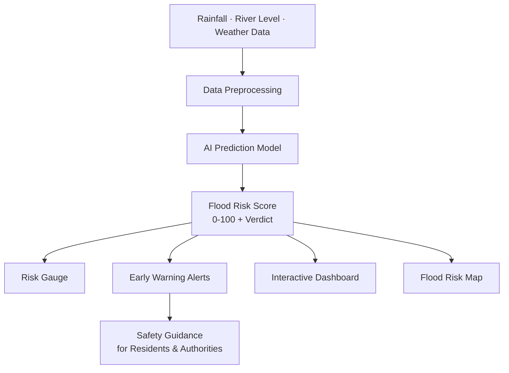

<div align="center">

# 🌊 JALRAKSHAK AI (जल रक्षक)

### Protector of Water — AI-Powered Flood Prediction & Early Warning

**Predict floods early. Protect lives. Build resilient communities.**

[](https://jal-rakshak-ai-flood-prediction.vercel.app/)
[](https://vercel.com)
[](https://react.dev)
[](https://www.typescriptlang.org)
[](#-tech-stack)
[](#-pwa--offline-capabilities)
[](LICENSE)

<br/>

### 🔗 [**⚡ LAUNCH THE LIVE PLATFORM ⚡**](https://jal-rakshak-ai-flood-prediction.vercel.app/)

**`https://jal-rakshak-ai-flood-prediction.vercel.app/`**

<br/>

[Overview](#-overview) · [Key Features](#-core-capabilities) · [How It Works](#️-system-architecture) · [Tech Stack](#-tech-stack) · [API Reference](#-api-reference) · [Setup](#-getting-started) · [Deployment](#️-deployment)

</div>

---

## 📌 Overview

Floods rarely arrive without warning signs. Heavy rainfall, rising river levels and saturated soil all show up in the data days or hours before water reaches a home. The problem is that this data is scattered, technical and hard for ordinary people and local authorities to act on in time.

**JalRakshak AI** (जल रक्षक — *"protector of water"*) closes that gap. It takes environmental and hydrological inputs, runs them through an AI prediction model, and turns the result into a clear **risk score, verdict and alert** that anyone can understand at a glance, so communities get the lead time they need to prepare, evacuate and reduce damage.

---

## ✨ Core Capabilities

### 🤖 AI Flood Risk Prediction
Enter rainfall, river level and weather conditions, and the model returns a flood likelihood with a risk score and a plain-language verdict.

### 🎚️ Visual Risk Gauge
A color-coded risk indicator turns an abstract model output into an instantly readable status (Low · Moderate · High · Critical), built for people who need an answer fast, not a paragraph.

### 🚨 Early Warning Alerts
Clear, actionable alerts and safety guidance matched to the predicted risk level, so users know what to do next, not just what might happen.

### 📊 Interactive Dashboard
A clean dashboard with trends, charts and a summary of current conditions, giving authorities and residents a single view of the situation.

### 🗺️ Flood Risk Map
Geographic visualization of at-risk regions so patterns and hotspots are easy to spot.

### 📱 Fully Responsive
Works smoothly on mobile, tablet and desktop, because warnings are most useful on the device people actually have in hand.

### 📡 Offline-Friendly Safety Info
Core safety guidance stays available even when connectivity drops, which is exactly when floods tend to strike.

### 🌐 Multilingual Interface
Designed for Indian communities, with language support so warnings are understood by the people who need them.

---

## 🧭 Who It's For

| Persona | How JalRakshak AI Helps |
|---|---|
| **Residents in flood-prone areas** | Simple risk status and clear safety steps |
| **Local authorities & disaster teams** | Early indicators to plan evacuation and resources |
| **Farmers & rural communities** | Advance notice to protect crops, livestock and property |
| **Students & researchers** | An open, extensible base for flood-prediction work |

---

## 🏗️ System Architecture



**Flow:** environmental inputs enter the platform → they are cleaned and normalized → the AI model estimates flood likelihood → the result drives the risk gauge, alerts, dashboard and map, ending in clear safety guidance.

---

## 🧰 Tech Stack

| Layer | Technology |
|---|---|
| **Frontend** | React, TypeScript, Tailwind CSS |
| **Visualization** | Charts & risk gauge components |
| **Backend** | Node.js / Python service for prediction |
| **AI / ML** | Machine-learning model for flood-risk prediction |
| **PWA** | Installable app with offline safety info |
| **Deployment** | Vercel |

<!-- ✏️ EDIT: replace the rows above with the exact libraries your project uses. -->

---

## 📱 PWA & Offline Capabilities

JalRakshak AI can be installed as a Progressive Web App and keeps key safety guidance cached, so essential information remains available when the network is unreliable during severe weather.

---

## 🚀 Getting Started

### Prerequisites
- **Node.js 18+**
- **Python 3.9+** *(only if you run the ML backend locally)*
- Any API keys your data sources require

### Installation

```bash
# 1. Clone the repository
git clone https://github.com/sathi2305/JalRakshak-AI-Flood-Prediction-.git
cd JalRakshak-AI-Flood-Prediction-

# 2. Install dependencies
npm install

# 3. Configure environment
cp .env.example .env

# 4. Start the dev server
npm run dev
```

The app runs at **http://localhost:3000**

### Environment Variables

```env
# Add the keys your project needs, for example:
API_KEY=
```

> 🔐 `.env` is gitignored. Never commit API keys, and rotate immediately if one is ever exposed.

---

## 🔌 API Reference

**Base URL:** `https://jal-rakshak-ai-flood-prediction.vercel.app/api`

| Method | Endpoint | Description |
|---|---|---|
| `POST` | `/predict` | Return flood risk score and verdict for the given inputs |
| `GET` | `/risk-levels` | List risk categories and thresholds |
| `GET` | `/health` | Service health check |

<!-- ✏️ EDIT: match these endpoints to your real routes, or delete this section if the app has no public API. -->

---

## 🗂️ Project Structure

```
JalRakshak-AI-Flood-Prediction-/
├── public/                    # Static assets, manifest, offline cache
├── api/                       # Serverless / backend routes
├── model/                     # Trained model & ML scripts
├── vercel.json                # Vercel configuration
├── .env.example               # Environment template
└── src/
    ├── main.tsx / App.tsx     # Entry point & routing
    ├── components/
    │   ├── Hero.tsx           # Landing section
    │   ├── Predictor.tsx      # Input form & prediction
    │   ├── RiskGauge.tsx      # Risk indicator
    │   ├── Dashboard.tsx      # Trends & summary
    │   └── Alerts.tsx         # Warning messages
    ├── utils/                 # Helpers & language files
    └── types.ts               # Shared types
```

<!-- ✏️ EDIT: replace with your real folder tree. -->

---

## ☁️ Deployment

Deployed on **Vercel**.

| Setting | Value |
|---|---|
| **Build Command** | `npm run build` |
| **Output Directory** | `dist` |
| **Environment Variables** | Add any required keys as secrets |

**Live URL:** https://jal-rakshak-ai-flood-prediction.vercel.app/

---

## 🗺️ Roadmap

- [x] AI-based flood risk prediction
- [x] Live deployment on Vercel
- [ ] Real-time weather and river-level API integration
- [ ] Location-based alerts via SMS, email and push notifications
- [ ] Interactive, live flood risk map
- [ ] Expanded regional language support
- [ ] Historical flood data analysis and model retraining
- [ ] Mobile app for field teams

---

## 🤝 Contributing

```bash
git checkout -b feature/your-feature-name
git commit -m "Add: clear description of your change"
git push origin feature/your-feature-name
# Open a Pull Request
```

Contributions, issues and feature requests are welcome.

---

## 📄 License

Distributed under the MIT License. See [`LICENSE`](LICENSE) for details.

---

## 👤 Author

**Sathiyamoorthi**

[](https://github.com/sathi2305)

---

<div align="center">

### ⭐ If this project helps you, consider starring the repository.

**[🌊 Try the Live Platform](https://jal-rakshak-ai-flood-prediction.vercel.app/)**

*जल रक्षक — because every community deserves time to prepare.*

</div>
