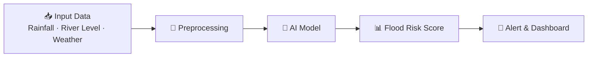

<div align="center">


### 🌊 Predict floods early. Protect lives. Build resilient communities.

<br/>

[](https://jal-rakshak-ai-flood-prediction.vercel.app/)
[](https://jal-rakshak-ai-flood-prediction.vercel.app/)
[](https://github.com/sathi2305/JalRakshak-AI-Flood-Prediction-)


<br/>

**[🌐 Live Demo](https://jal-rakshak-ai-flood-prediction.vercel.app/)** &nbsp;•&nbsp; **[✨ Features](#-features)** &nbsp;•&nbsp; **[🛠 Tech Stack](#-tech-stack)** &nbsp;•&nbsp; **[⚙️ Getting Started](#️-getting-started)** &nbsp;•&nbsp; **[🤝 Contributing](#-contributing)**

</div>

---

<div align="center">

## 📖 About

</div>

<p align="center">
<b>JalRakshak AI</b> ("Jal Rakshak" means <i>Protector of Water</i>) is an intelligent flood prediction platform that analyzes environmental and hydrological data to forecast flood risk and deliver timely, easy-to-understand alerts.
<br/><br/>
Our goal is simple: give communities and authorities the lead time they need to prepare, evacuate and reduce damage.
</p>

---

<div align="center">

## 🚀 Live Demo

<a href="https://jal-rakshak-ai-flood-prediction.vercel.app/">
  
</a>

<br/><br/>

🔗 **https://jal-rakshak-ai-flood-prediction.vercel.app/**

<!-- Add a screenshot or GIF here:

-->

</div>

---

<div align="center">

## ✨ Features

</div>

<div align="center">

| 🤖 **AI Predictions** | 📊 **Risk Assessment** | 🚨 **Early Warnings** |
|:---:|:---:|:---:|
| Machine-learning model forecasts flood likelihood from input data | Clear risk levels so anyone can understand the situation at a glance | Timely alerts that support faster, safer decisions |

| 🎨 **Modern Interface** | 📱 **Fully Responsive** | ⚡ **Fast & Reliable** |
|:---:|:---:|:---:|
| Clean, intuitive dashboard | Works on mobile, tablet and desktop | Deployed on Vercel for quick global access |

</div>

---

<div align="center">

## 🛠 Tech Stack


<!-- Edit the badges above to match what your project actually uses (React, Next.js, Flask, scikit-learn, TensorFlow, etc.) -->

</div>

---

<div align="center">

## 🧠 How It Works

</div>

<div align="center">



</div>

---

<div align="center">

## ⚙️ Getting Started

</div>

### Prerequisites

- Git
- Node.js (v18+) and/or Python (3.9+), depending on the parts you run

### Installation

```bash
# 1. Clone the repository
git clone https://github.com/sathi2305/JalRakshak-AI-Flood-Prediction-.git

# 2. Move into the project folder
cd JalRakshak-AI-Flood-Prediction-

# 3. Install dependencies
npm install          # for the web app
# pip install -r requirements.txt   # for the ML / backend part

# 4. Start the development server
npm run dev
```

Then open **http://localhost:3000** (or the port shown in your terminal).

---

<div align="center">

## 📂 Project Structure

</div>

```text
JalRakshak-AI-Flood-Prediction-/
├── public/            # Static assets
├── src/               # Application source code
├── model/             # Trained model & ML scripts
├── README.md
└── ...
```

<!-- Update this tree to match your real folder structure. -->

---

<div align="center">

## 🗺 Roadmap

</div>

- [x] AI-based flood risk prediction
- [x] Live deployment on Vercel
- [ ] Real-time weather & river-level API integration
- [ ] Location-based alerts (SMS / email / push)
- [ ] Interactive flood risk map
- [ ] Multi-language support (English, Hindi, Tamil)

---

<div align="center">

## 🤝 Contributing

</div>

<p align="center">
Contributions, issues and feature requests are welcome!
</p>

1. Fork the project
2. Create your feature branch: `git checkout -b feature/AmazingFeature`
3. Commit your changes: `git commit -m "Add AmazingFeature"`
4. Push to the branch: `git push origin feature/AmazingFeature`
5. Open a Pull Request

---

<div align="center">

## 📄 License

Distributed under the **MIT License**. See `LICENSE` for more information.

<br/>

## 👨‍💻 Author

**Sathi**

[](https://github.com/sathi2305)

<br/>

### ⭐ If you find this project useful, please give it a star!

<br/>


<sub>Built with 💙 to protect communities from floods.</sub>

</div>
